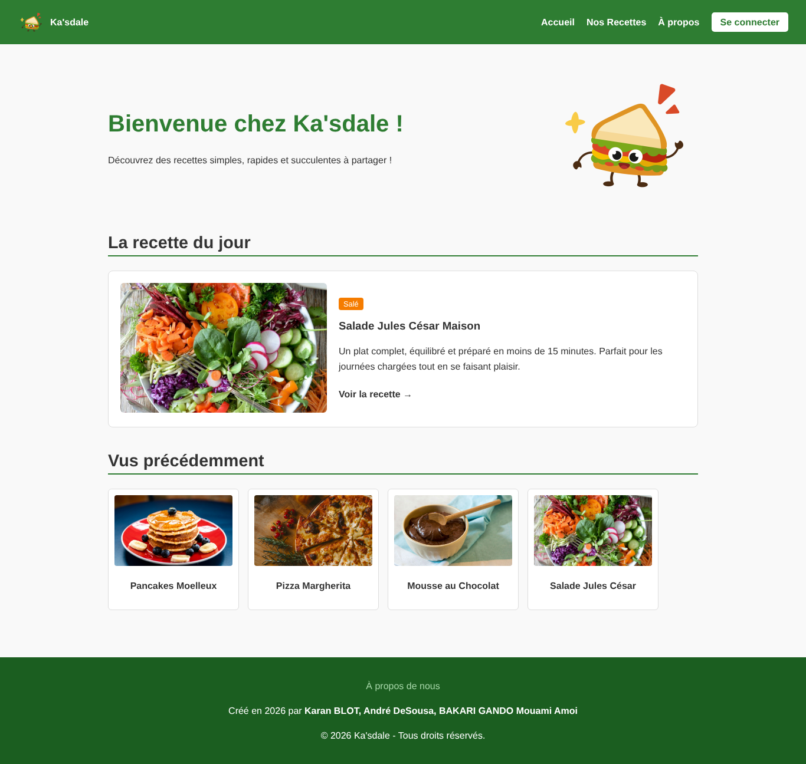
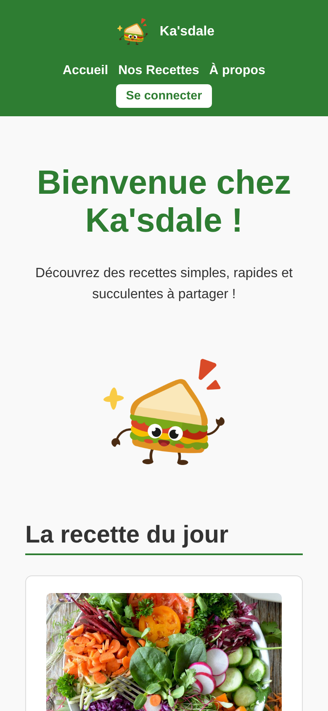
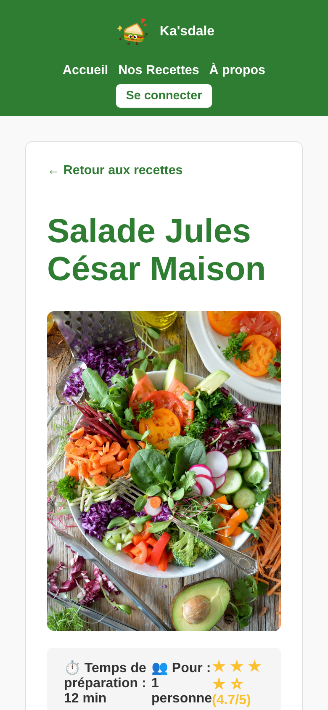
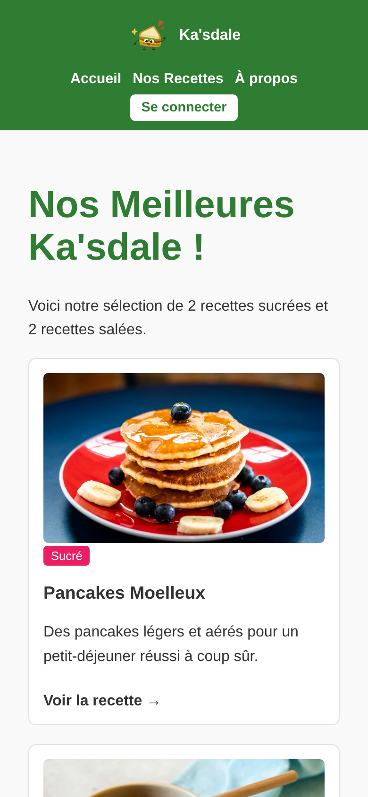

# Ka'sdale · Site de recettes pour étudiants

Site vitrine en **HTML et CSS** proposant des recettes simples, rapides et pas chères pour les étudiants.
Projet de groupe réalisé en 1re année de Bachelor Informatique à l'ESGI Paris (octobre 2026).

**[Voir le site en ligne](https://lyli-netizen.github.io/kasdale-recettes/)**



## L'équipe

| Membre | Rôle sur le projet |
|---|---|
| Karan BLOT | Développement HTML/CSS |
| André De Sousa | Développement HTML/CSS |
| Mouami Amoi BAKARI GANDO | **[À COMPLÉTER : pages et éléments réalisés]** |

## Ce que contient le site

- **Accueil** : bannière avec la mascotte, recette du jour, carrousel « Vus précédemment »
- **Nos recettes** : liste des recettes classées (salé / sucré)
- **4 fiches recettes** : salade César, pizza Margherita, pancakes, mousse au chocolat
- **À propos** : mission du site, présentation de l'équipe, réseaux sociaux et contact

## Compétences mises en œuvre

- HTML5 sémantique (`header`, `nav`, `main`, `section`, `article`, `footer`)
- CSS3 : Flexbox, cartes, badges, survols
- **Responsive design** avec media queries (affichage adapté au mobile en dessous de 820 px)
- Navigation cohérente sur toutes les pages, charte graphique commune
- Travail en équipe : répartition des pages, maquettes préparatoires (dossier `docs/`)

## Aperçu mobile

<p>
  
  
  
</p>

## Structure

```
├── accueil.html            Page d'accueil
├── recettes.html           Liste des recettes
├── salade.html, pizza.html, pancake.html, mousse-au-chocolat.html
├── apropos.html            Mission et équipe
├── design.css              Feuille de style unique
├── images/                 Photos et logo
├── docs/                   Maquettes préparatoires (PDF)
└── captures/               Captures d'écran du README
```

## Lancer le site en local

Aucune installation nécessaire : ouvrir `accueil.html` dans un navigateur.

---

Projet pédagogique ESGI, publié avec l'accord des membres du groupe.
